<div align="center">


# VC Pokedex

### Bloomberg for startup portfolios

Type a startup's name. Six AI agents research it on the open web, benchmark it
against **232 real SEC filings**, score it on five dimensions, write an investment
memo — and pin it on a map at its headquarters.

<br />

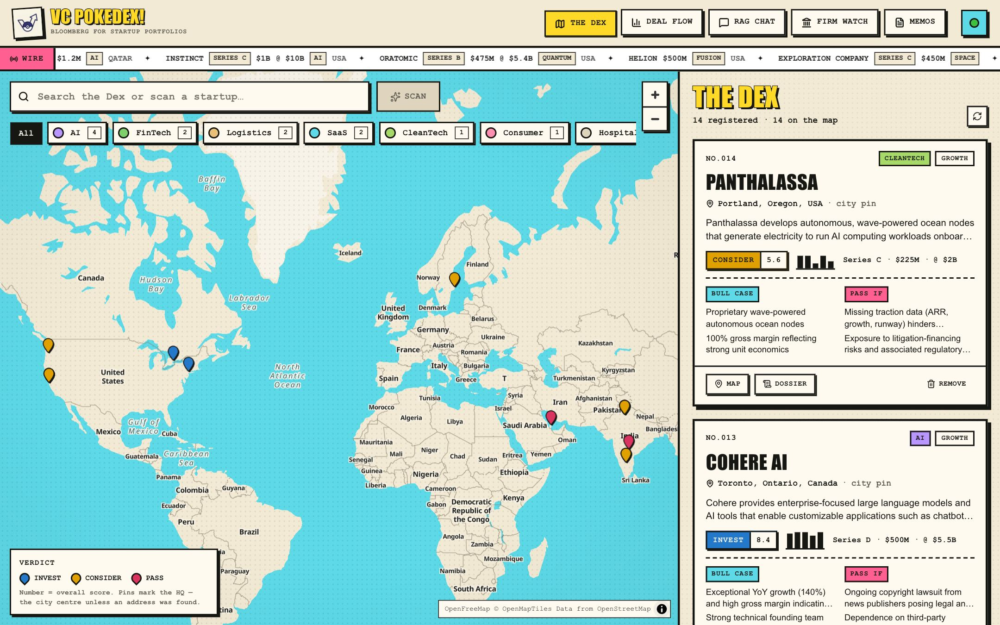

<sub>The home screen — the Dex. Every pin is a company, coloured by verdict, with its score inside.</sub>

</div>

---

## Contents

- [What it does](#what-it-does)
- [Feature tour](#feature-tour)
- [How it works](#how-it-works)
- [Quick start](#quick-start)
- [The provider chain](#the-provider-chain)
- [The comps corpus](#the-comps-corpus)
- [API](#api)
- [Testing](#testing)
- [Design notes](#design-notes)
- [Security](#security)
- [Project layout](#project-layout)

---

## What it does

There is no upload step and no data entry. Type `Ramp`, and about twenty seconds
later you have a scored dossier: what the company does, what it raised and at
what valuation, who founded it and what they did before, who it competes with,
what diligence would turn up, a full written memo — and a pin on the map.

| | |
|---|---|
| **Input** | a company name |
| **Output** | profile · funding · comparables · founders · competitors · risks · scorecard · memo · map pin |
| **Latency** | ~2s to acknowledge, ~20s to a complete entry |
| **Grounding** | live web research + 232 SEC Form D filings |

---

## Feature tour

<table>
<tr>
<td width="50%" valign="top">

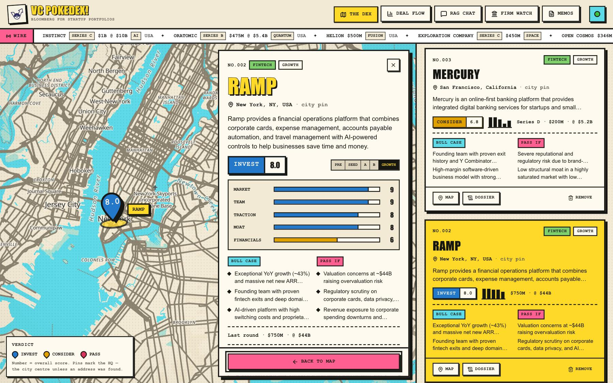

### Spotlight

Click any pin or card. The map flies in and, as it slows over the city, the
company is put in the spotlight: its pin sized up, every other pin faded, and a
card that opens on the first look — the verdict and score, five dimension
scores, the bull case and the pass-if case, and the last round. **Back to map**,
a second click, or <kbd>Esc</kbd> returns to the full view.

**Use it to**
- get a ten-second read on a company before a call
- weigh the case for against the case against at a glance

</td>
<td width="50%" valign="top">

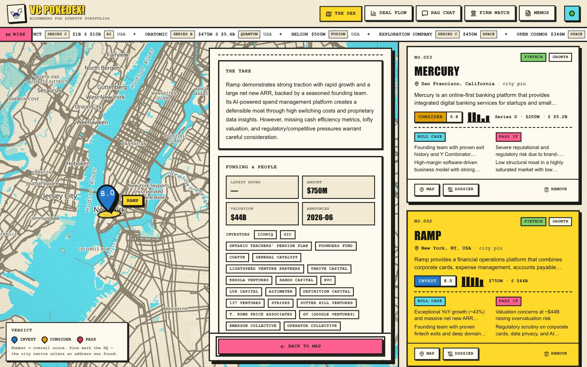

### The full dossier, in the same card

Keep scrolling the spotlight card and the whole dossier is right there, while
the map stays put: the agents' take, funding and every investor, founders with
their track records, the competitive landscape with a moat score, recent news,
computed financial ratios and the full memo.

**Use it to**
- prep for a partner meeting without leaving the map
- trace a score back to the founders, rivals and news behind it

</td>
</tr>
<tr>
<td width="50%" valign="top">

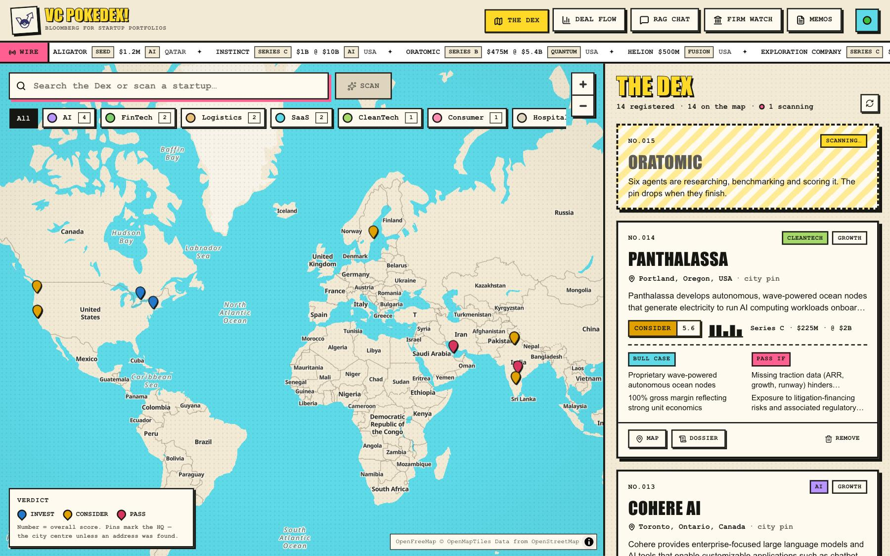

### Scan any startup

Type a name in the search bar and hit **Scan**. The entry appears straight away
as a hatched *scanning…* card while six agents research, benchmark and score it;
when they finish, the pin drops and the map flies to it. A scan that fails says
why, instead of spinning forever.

**Use it to**
- check out a company you just heard about on a podcast or in a deck
- build a watchlist one name at a time

</td>
<td width="50%" valign="top">

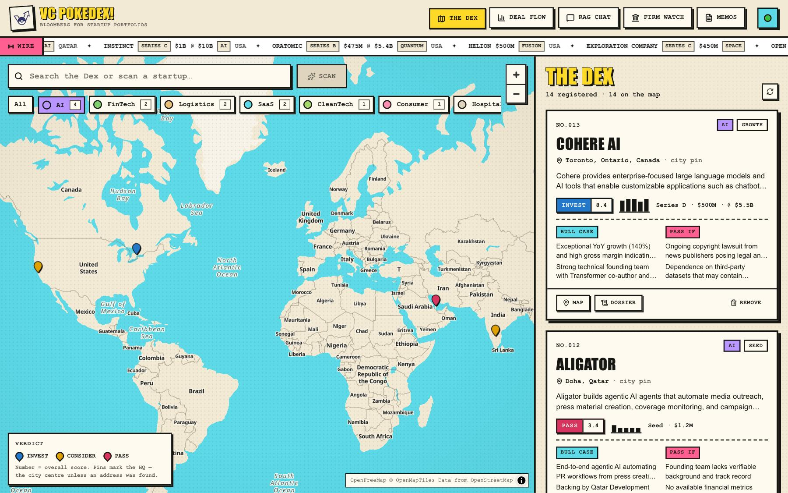

### Search and filter

The same bar filters the Dex as you type, and sector chips narrow both the list
and the map. Press <kbd>Enter</kbd> on a name that's already in the Dex and it
opens instead of being scanned twice.

**Use it to**
- see every AI company you've screened, and where they are
- jump straight to a company by name

</td>
</tr>
<tr>
<td width="50%" valign="top">

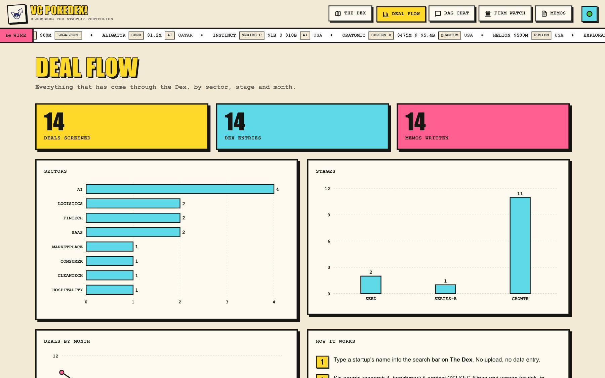

### Deal Flow

Everything that has come through the Dex, in aggregate: deals screened, entries
and memos, the sector mix as a ranked bar chart, the stage mix, and deals per
month.

**Use it to**
- show portfolio composition in an LP update or a partner meeting
- see whether your pipeline is skewing to one sector or stage

</td>
<td width="50%" valign="top">

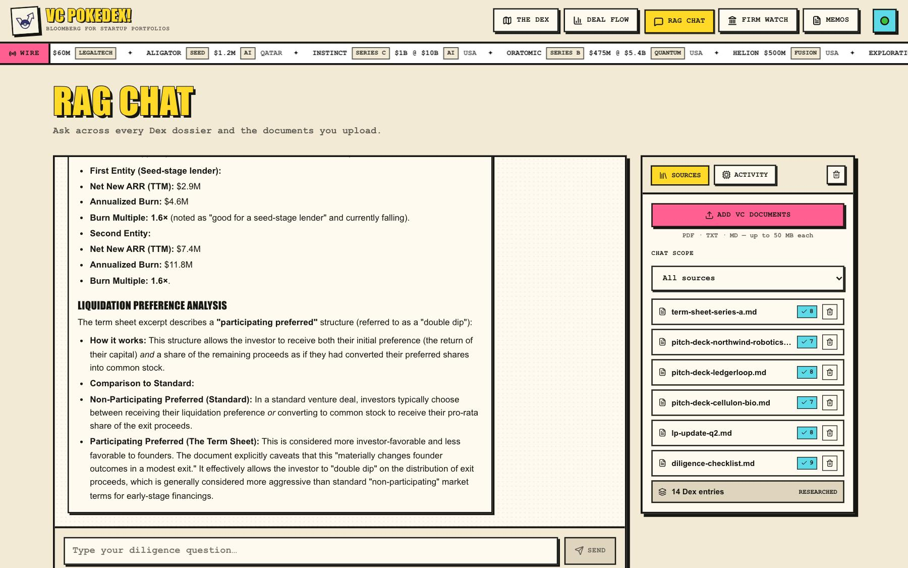

### RAG Chat and your documents

Ask questions across every Dex dossier and your own documents — term sheets,
decks, LP updates, data-room exports (PDF, TXT or MD, up to 50 MB). Scope a
question to a single document, or ask across everything. The **Activity** tab
traces each retrieval so a wrong answer can be read back to the chunk behind it.

**Use it to**
- compare a deck's claims against the term sheet
- pull one number out of a long data-room export

</td>
</tr>
<tr>
<td width="50%" valign="top">

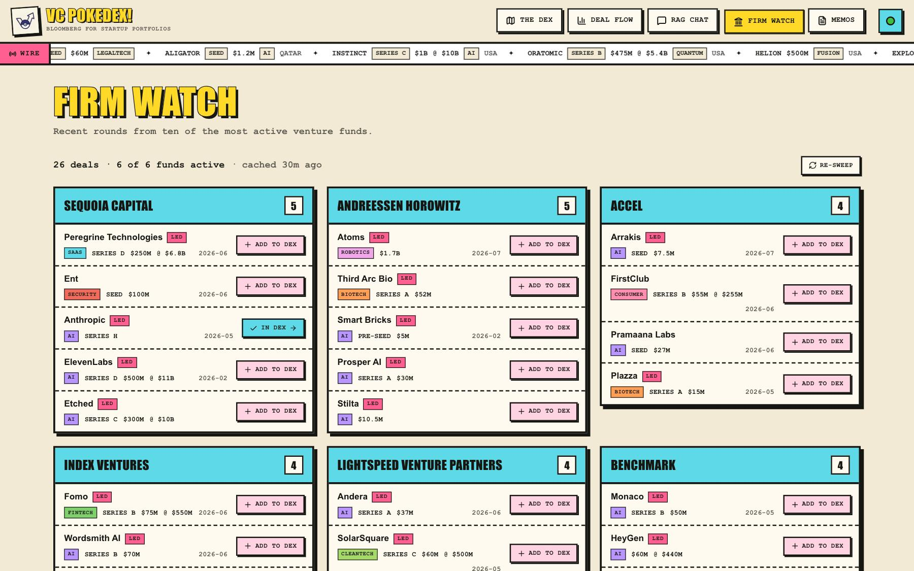

### Firm Watch

Recent investments by ten of the most active global funds — Sequoia, a16z,
Accel, Index, Lightspeed, Benchmark and more — with a `LED` badge for rounds a
fund led. Every company has **Add to Dex**; ones already scanned show **In Dex**
and open on the map, even when the names differ slightly (*Anthropic PBC*,
*Linear Inc.*).

**Use it to**
- follow what top funds are backing this quarter
- research any of those companies in one click

</td>
<td width="50%" valign="top">

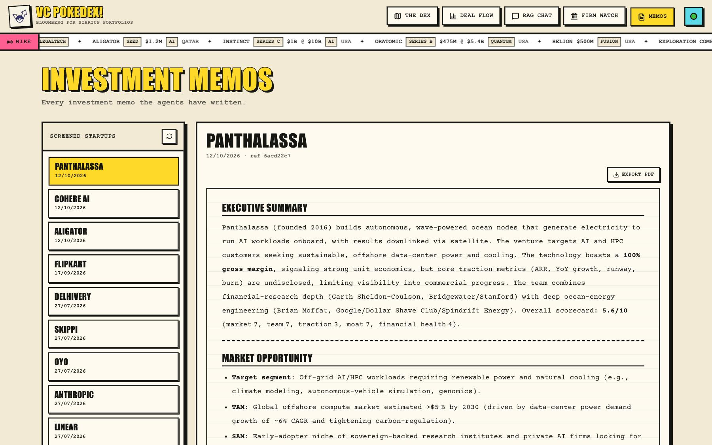

### Investment memos

Every scan writes a structured memo — executive summary, market, business model,
financials, comparables, team, competition, risks and a recommendation with a
conviction score — set in a typewriter face on ruled paper.

**Use it to**
- read the written case behind a score
- start your own memo from a solid first draft

</td>
</tr>
<tr>
<td width="50%" valign="top">

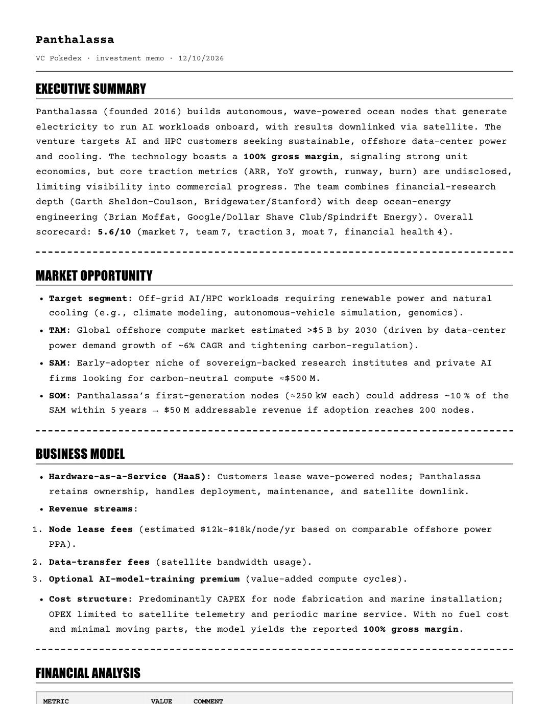

### Export to PDF

**Export PDF** goes through the browser's print pipeline: real, selectable text,
clean page breaks, ink on white paper, and nothing else from the app on the page.

**Use it to**
- send a memo to partners or an investment committee
- archive the analysis as it stood on the day

</td>
<td width="50%" valign="top" align="center">

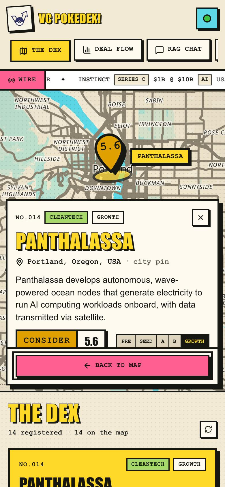

### On your phone

The map sits on top and the Dex flows below it; the spotlight, dossier and all,
becomes a scrolling sheet at the bottom of the map.

**Use it to**
- look a company up between meetings

</td>
</tr>
</table>

**Also on every page:** a live **funding wire** of notable raises worldwide
across the top, and a status tile — green when every backing service is up, red
when one isn't — that opens into the detail.

> Figures in the Dex are the agents' reading of public web sources at scan time.
> They are a starting point for diligence, not verified data.

---

## How it works

Six agents, five of them concurrent, orchestrated as a LangGraph `StateGraph`
with a corrective-RAG loop. After the memo, the company's HQ is geocoded and the
entry is pinned.

```
                        name  ──►  research_agent
                                   Tavily: product / funding / people /
                                   traction + a recency-biased news pass
                                          │  dossier
                                          ▼
                                   ┌─────────────┐
                                   │   profile   │  structured facts + funding
                                   └──────┬──────┘
              ┌───────────┬───────────┬───┴───────┬───────────┐
              ▼           ▼           ▼           ▼           ▼   (concurrent)
        ┌──────────┐┌──────────┐┌──────────┐┌──────────┐┌──────────┐
        │  comps   ││financials││ founders ││competitors││   risk   │
        │ SEC      ││ ratios + ││  track   ││ landscape ││ red flags│
        │ Form D   ││ judgment ││  record  ││  + moat   ││ from news│
        └────┬─────┘└────┬─────┘└────┬─────┘└─────┬─────┘└────┬─────┘
             └───────────┴───────────┴────────────┴───────────┘
                                   ▼
                          ┌─────────────────┐
                          │ grade_retrieval │  are these comps actually relevant?
                          └────────┬────────┘
                     irrelevant ───┴─── relevant
                          │                 │
                 ┌────────▼───────┐         ▼
                 │ rewrite_query  │    ┌────────┐   ┌────────┐
                 └────────┬───────┘    │ score  │──►│  memo  │──► END
                          │            └────────┘   └────────┘
                          └──► comps (max 2 rewrites)
```

| Agent | Question it answers | Source |
|---|---|---|
| `profile` | What is it, what stage, what did it raise, where is it based? | the research dossier |
| `comps` | What did similar deals price at? | 232 SEC Form D filings, hybrid RAG |
| `financials` | Is the burn / growth / margin profile healthy? | deterministic ratios + judgment |
| `founders` | Who are these people, what have they shipped? | per-founder web search |
| `competitors` | Who else builds this, is there a moat? | market web search |
| `risk` | What would diligence turn up? | recent news |

> **Node contract.** Every node returns *only* the state keys it owns. Returning
> `{**state, ...}` makes the five concurrent nodes write every channel in the same
> superstep, which LangGraph rejects with `InvalidUpdateError`. Regression tests
> live in `tests/test_orchestrator.py`.

### Stack

| Layer | Choice |
|---|---|
| LLM | `google/gemini-3.1-flash-lite` via OpenRouter, failing over to free models and Gemini direct |
| Embeddings | `gemini-embedding-001` (3072 dims) |
| Orchestration | LangGraph `StateGraph` — parallel fan-out + CRAG loop |
| Vector DB | ChromaDB `PersistentClient` + BM25, fused with Reciprocal Rank Fusion |
| Document DB | MongoDB (Motor async driver) |
| Web research | Tavily (multi-angle + news) |
| Map | MapLibre GL · OpenFreeMap vector tiles · Nominatim geocoding (all keyless) |
| API | FastAPI, background jobs, SSE streaming |
| Frontend | Vite · React 19 · TypeScript · Recharts |

### Where the pins come from

HQs are geocoded with OpenStreetMap's Nominatim — one lookup per company, cached
in Mongo, paced to its one-request-per-second policy. A street address pins the
building; otherwise the pin marks the city centre and the card says *city pin*.
Companies that share a city fan out on a small ring so every pin stays
clickable. Deals scanned before the map existed are pinned by a backfill when
the server starts.

---

## Quick start

```bash
git clone https://github.com/tridibjena/vc-pokedex.git && cd vc-pokedex
cp .env.example .env          # add GEMINI_API_KEY + TAVILY_API_KEY

python -m venv venv && source venv/bin/activate
pip install -r requirements.txt
cd dashboard && npm install && npm run build && cd ..

docker compose up -d          # MongoDB + Mongo Express
python seed_edgar.py          # 232 real comps from SEC Form D
python seed_library.py        # 6 sample VC documents for RAG chat
uvicorn api.main:app --port 8000
```

Open **http://localhost:8000**. The API serves the built dashboard; you only need
Vite (`cd dashboard && npm run dev`) when editing frontend code.

> **Seed before you start the server, not after.** ChromaDB's `PersistentClient`
> is a single-process store; writing to it under a live server leaves that server
> with a stale index. The seed scripts detect a running server and refuse — pass
> `--allow-running-api` to override, and restart afterwards.

### Keys

| Variable | Required | Free at |
|---|---|---|
| `GEMINI_API_KEY` | **yes** — embeddings run on Gemini whatever the chain | [aistudio.google.com](https://aistudio.google.com/) |
| `TAVILY_API_KEY` | **yes** — all research runs on it | [tavily.com](https://tavily.com) |
| `OPENROUTER_API_KEY` | recommended — the primary model needs a few dollars of credit | [openrouter.ai/keys](https://openrouter.ai/keys) |
| `GEOCODER_USER_AGENT` | optional — add a contact address, as Nominatim's policy asks | — |

OpenRouter legs are skipped when the key is absent, so the default config runs on
Gemini alone. Set `GEOCODING_ENABLED=false` to run without the map's geocoder.

---

## The provider chain

Generation walks an ordered chain across vendors. A `429` (rate limit) or `402`
(spent credits) advances to the next leg; any other error fails immediately
rather than burning through the chain.

```
openrouter:google/gemini-3.1-flash-lite            ← primary
openrouter:nvidia/nemotron-3-super-120b-a12b:free  ← free fallbacks
openrouter:openai/gpt-oss-20b:free
openrouter:openrouter/free
gemini-3.6-flash → gemini-3.1-flash-lite → gemini-3-flash-preview → gemini-3.5-flash
```

| Free-tier limit | Cap | Handling |
|---|---|---|
| OpenRouter free models | 50 requests/day without credits | failover to Gemini |
| Gemini `generate_content` | 5/min and 20/day **per model** | sliding-window pacing; failover across models |
| Gemini `embed_content` | 100/min, metered **per input item** | item-level pacing |

Set `GENERATE_REQUESTS_PER_MINUTE=0` and `EMBED_ITEMS_PER_MINUTE=0` to disable
pacing on a paid plan. Model IDs are pinned exactly — never a `latest` alias —
and `tests/test_agents.py::TestModelPins` fails the build if one appears.

---

## The comps corpus

`comps` doesn't retrieve from a synthetic list. It searches **232 real SEC Form D
filings** — the notice filed for essentially every US private round. Funds,
real-estate and oil-and-gas vehicles are excluded by allowlist (10,135 of 15,735
filings in 2026Q1 are pooled investment funds alone), leaving ~1,485 genuine
venture rounds per quarter.

Form D gives the issuer, sector, location, year, **actual amount raised**,
revenue band and related persons. It does **not** give ARR, burn or headcount,
and stage is *inferred* from round size and labelled as such. See
[SEEDING.md](SEEDING.md).

Retrieval runs a dense leg (Gemini embeddings) and a sparse leg (BM25), fuses
them with Reciprocal Rank Fusion, then re-orders the fetched rows by fused rank.
The comps (`vc_comps`) and the scanned dossiers plus uploaded documents
(`vc_documents`) live in separate collections, so a company is never benchmarked
against itself and nothing you upload can move a scorecard.

---

## API

| Method | Path | Purpose |
|---|---|---|
| `POST` | `/research` | **Scan a company by name.** Returns `202`; analysis runs in the background. |
| `GET` | `/research/status/{file_id}` | Poll a scan: `processing` / `complete` / `failed` |
| `GET` | `/research/documents` | Every Dex entry, with its scan status |
| `DELETE` | `/research/documents/{doc_id}` | Remove an entry, its chunks, deal and memo |
| `GET` | `/research/ticker` | Recent global raises (3h cache) |
| `GET` | `/research/firms` | Top-fund activity (6h cache) |
| `GET` | `/reports/deals` | Deal cards: scores, verdict, bull/bear case, HQ coordinates |
| `GET` | `/reports/deals/{id}` | Full scorecard, ratios, founders, competitors |
| `GET` | `/reports/deals/{id}/memo` | The investment memo |
| `GET` | `/reports/deals/{id}/news` | Recent coverage |
| `GET` | `/reports/trends` | Sector / stage / monthly aggregates |
| `POST` | `/library/documents` | **Upload a reference document.** `202`; indexing runs in the background. |
| `GET` | `/library/documents` | Uploaded documents, with indexing status |
| `DELETE` | `/library/documents/{file_id}` | Remove a document and its chunks |
| `POST` | `/chat` · `/chat/stream` | RAG chat, optionally scoped to one `file_id` |
| `GET` | `/health` | Service status — never calls the LLM |

Interactive docs at `/docs`.

### Financial ratios

`tools/calculator.py` is pure Python and never calls an LLM. Burn is annualised
before the burn-multiple division so both sides cover the same period, inputs
like `"$5M"`, `"1.2 bn"` or `"(500,000)"` parse leniently, and any metric whose
inputs are missing returns `None` rather than a guess.

| Metric | Formula |
|---|---|
| `burn_multiple` | (monthly burn × 12) ÷ net new ARR |
| `runway_months` | cash ÷ monthly burn |
| `yoy_growth` | (ARR − prev ARR) ÷ prev ARR × 100 |
| `gross_margin` | (revenue − COGS) ÷ revenue × 100 |
| `arr_per_head` | ARR ÷ headcount |

---

## Testing

```bash
pytest -q                        # 168 tests, no network calls
cd dashboard && npm run build    # tsc + vite
```

The Gemini SDK is faked at the client boundary and Nominatim at the HTTP
boundary (`tests/conftest.py`, `tests/test_geocode.py`), so prompt construction,
JSON parsing, graph wiring, geocoder pacing and caching are all exercised for
real while the suite stays offline and fast.

---

## Design notes

A comic-book look after [blrcuts.com](https://blrcuts.com): cream newsprint
canvas, ink outlines, flat yellow / pink / cyan fills, hard offset shadows,
square corners. Impact for headlines, Courier for labels and controls, Courier
Prime for memos. The basemap is recoloured to the same palette before its first
paint, under a halftone dot screen.

**Verdict colour is validated, not chosen by eye.** Pins and badges use blue /
amber / crimson for INVEST / CONSIDER / PASS — blue rather than the usual green,
because green and red collapse under deuteranopia, the one pair a reader most
needs to tell apart. Checked with a palette validator against the canvas: worst
colour-blind ΔE 16.9, normal-vision ΔE 26.1. Amber sits below 3:1 on cream, so
colour never stands alone: every pin has an ink outline and its score inside,
every badge carries the verdict word, and the map has a legend.

Charts are single-series — sectors as a ranked bar chart rather than a donut —
so the axis carries identity and no categorical palette is needed.

---

## Security

- `CORS_ORIGINS` must list explicit origins. With credentials enabled, Starlette
  echoes the caller's `Origin` rather than sending `*`, so a wildcard lets any
  site issue credentialed cross-origin requests.
- The SPA catch-all resolves static files inside `dist` only, with a traversal
  guard verified against `../`, `%2f` and `%2e%2e` encodings.
- `.env`, `.env.*` and `*.bak` are gitignored — API keys never reach the repo.

---

## Project layout

```
agents/          LangGraph nodes — one file per agent, plus orchestrator.py
tools/           LLM client, providers, vector store, Mongo, calculator, search,
                 EDGAR parsing, geocoding
api/             FastAPI app, schemas, routes
pipelines/       Research and analysis orchestration
dashboard/       Vite + React SPA
  src/components/  DexExplorer (map + list), DexMap, SpotlightCard, DealDetail,
                   DexCard, ScanBar, DashboardPanel, ChatPanel, SourcesPanel,
                   FirmsPanel, MemoPanel, Header, Ticker
samples/         Six fictional VC documents for RAG chat
tests/           pytest suite
seed_edgar.py    Real comps from SEC Form D
seed_comps.py    Synthetic fallback for offline demos
seed_library.py  Sample documents into the RAG chat library
```

## License

MIT — see [LICENSE](LICENSE).
